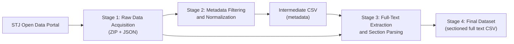

# An Automated Pipeline for Building Structured Judicial Datasets from the Brazilian Superior Court of Justice (STJ) Open Data Portal

---

## Table of Contents

1. [Overview](#1-overview)
2. [Research Context and Motivation](#2-research-context-and-motivation)
3. [Data Source](#3-data-source)
4. [Methodology](#4-methodology)
5. [Dataset Construction Rules](#5-dataset-construction-rules)
6. [Output Data Schema](#6-output-data-schema)
7. [Reproducibility](#7-reproducibility)
8. [Repository Organization](#8-repository-organization)
9. [Limitations and Threats to Validity](#9-limitations-and-threats-to-validity)
10. [Ethical and Legal Considerations](#10-ethical-and-legal-considerations)
11. [How to Cite](#11-how-to-cite)
12. [Authorship and Contact](#12-authorship-and-contact)

---

## 1. Overview

This artifact implements an end-to-end, configurable data pipeline that builds a structured, research-ready dataset of court rulings from the public open data portal of the Brazilian **Superior Tribunal de Justiça (STJ)**. The pipeline:

- automatically acquires the raw metadata (JSON) and full-text rulings (ZIP/TXT) published in the *Diário da Justiça Eletrônico* (DJe);
- filters records by document type, procedural class, and filing date;
- normalizes heterogeneous date formats and textual noise;
- segments each ruling into its legally meaningful sections (*Acórdão*, *Ementa*, *Relatório*, *Voto*, *Decisão*) through rule-based parsing;
- exports two consolidated CSV files (metadata and full-text sections) linked by a unique document identifier.

The resulting dataset supports two downstream prediction tasks investigated in the study: **(i) prediction of case processing time** and **(ii) prediction of the judicial outcome**.

## 2. Research Context and Motivation

Brazilian higher courts handle a very large volume of cases, and the STJ publishes its rulings as open data. However, these data are distributed across thousands of daily files, follow formats that vary over time, and are not directly suitable for Machine Learning (ML) or Natural Language Processing (NLP) experiments. Building a reliable corpus therefore requires a transparent and reproducible extraction procedure.

The goal of this artifact is to make that procedure **explicit, auditable, and repeatable**, so that reviewers and other researchers can (a) inspect how the corpus was produced and (b) regenerate it for other periods, document types, or procedural classes (e.g., *Habeas Corpus* — `HC`, *Recurso Especial* — `REsp`).

## 3. Data Source

| Attribute | Description |
|-----------|-------------|
| **Provider** | Superior Tribunal de Justiça (STJ), Brazil |
| **Portal** | [STJ Open Data Portal](https://dadosabertos.web.stj.jus.br/) |
| **Dataset** | [*Íntegras de decisões terminativas e acórdãos do Diário da Justiça*](https://dadosabertos.web.stj.jus.br/dataset/integras-de-decisoes-terminativas-e-acordaos-do-diario-da-justica) |
| **Metadata files** | `metadadosYYYYMMDD.json` — one record per ruling (process number, publication date, rapporteur, document type, subjects, etc.) |
| **Full-text files** | `YYYYMMDD.zip` — archives containing one `.txt` file per ruling, named after its `SEQDOCUMENTO` |
| **Language** | Brazilian Portuguese |
| **Access** | Public, no authentication required |

The official data dictionary is reproduced in [`_doc/dicionariointegrasdecisoes.csv`](_doc/dicionariointegrasdecisoes.csv).

## 4. Methodology

The pipeline is organized into four sequential stages, orchestrated by [`main.py`](main.py) and implemented in [`lib.py`](lib.py).



### Stage 1 — Raw Data Acquisition
`download_zip_files()` and `download_json_metadados()` scrape the dataset page and download the ZIP and JSON files for the configured year (and, optionally, month). Files already present locally are skipped, which makes the process **idempotent and resumable**; a full re-download can be forced through the `FORCE-DOWNLOAD` parameter.

### Stage 2 — Metadata Filtering and Normalization
`json_directory_to_csv()` parses every metadata file and retains only records that satisfy all of the following filters:

- **Document type** — `ACÓRDÃO` (collegiate judgment), `DECISÃO` (monocratic decision), or both (`GERAL`);
- **Procedural class** — matched against the `PROCESSO` field (e.g., `HC`);
- **Filing-date cut-off** — applied to `DATARECEBIMENTO` when rule RN01 is active (see [Section 5](#5-dataset-construction-rules)).

During this stage, fields are cleaned (removal of line breaks, tabs, and HTML `<br>` tags) and all date fields are normalized to `DD/MM/YYYY`. The following input formats are recognized:

| Family | Supported formats |
|--------|-------------------|
| Numeric | `YYYYMMDD`; Unix timestamp in seconds; Unix timestamp in milliseconds |
| ISO 8601 | `YYYY-MM-DD`, `YYYY-MM-DD HH:MM:SS`, `YYYY-MM-DDTHH:MM:SS`, with optional fractional seconds and timezone (`Z`, `+00:00`) |
| Brazilian | `DD/MM/YYYY`, `DD/MM/YYYY HH:MM`, `DD/MM/YYYY HH:MM:SS` |

Records whose dates cannot be interpreted are not silently discarded: they are logged together with their `SEQDOCUMENTO`, `NUMEROREGISTRO`, and source file for later auditing.

### Stage 3 — Full-Text Extraction and Section Parsing
`read_txt_files_and_create_csv()` uses the filtered metadata as an index. For each selected `SEQDOCUMENTO`, the corresponding `.txt` file is read **directly from inside the ZIP archives** (hybrid mode), avoiding full decompression; only the texts that belong to the filtered subset are persisted to disk.

Each document is then segmented by regular-expression-based parsing into the sections *Acórdão*, *Ementa*, *Relatório*, *Voto*, and *Decisão*. Documents beginning with `DECISÃO` or `DESPACHO` are handled as monocratic decisions. To cope with formatting variations over time, the *Relatório* extraction applies a hierarchical fallback strategy (`O RELATÓRIO.` → `EMENTA<br>` → `<br>EMENTA`). Documents for which a section cannot be located are logged (`report_not_found.txt`). A detailed description of the text sanitization procedure is available in [`_doc/HIGIENIZACAO_CAMPO_RELATORIO.md`](_doc/HIGIENIZACAO_CAMPO_RELATORIO.md) (in Portuguese).

### Stage 4 — Final Dataset Assembly
The extracted sections are consolidated into a single CSV file, one row per ruling, keyed by `SEQDOCUMENTO` and joinable with the metadata CSV produced in Stage 2.

## 5. Dataset Construction Rules

Two construction rules, selected through the `REGRA-PREDICAO` parameter, define how the corpus is assembled for each prediction task:

| ID | Value | Target task | Rule |
|----|-------|-------------|------|
| **RN01** | `TEMPO` | Processing-time prediction | Only cases whose filing date (`DATARECEBIMENTO`) is on or after the cut-off date given by `ANO-PUBLICACAO-DJE` are retained. This avoids left-censoring bias, i.e., including cases filed long before the observation window whose duration would be misrepresented. |
| **RN02** | `DECISAO` | Judicial-outcome prediction | The most recent decision for each case is considered, with **no** restriction on the DJe publication date. |

## 6. Output Data Schema

All outputs are UTF-8 encoded, semicolon-delimited (`;`), fully quoted CSV files written to `<DATA_ROOT>/output/<YEAR>/`, where `<DATA_ROOT>` is defined in [`const.py`](const.py).

**(a) Metadata file** — `metadados-<type>-dj<period>.csv`

| Field | Description |
|-------|-------------|
| `SEQDOCUMENTO` | Unique document identifier (primary key) |
| `DATAPUBLICACAO` | DJe publication date |
| `TIPODOCUMENTO` | Document type (*Acórdão* / *Decisão*) |
| `NUMEROREGISTRO` | Case registration number |
| `PROCESSO` | Procedural class and case number |
| `DATARECEBIMENTO` | Date the case was received by the court |
| `DATADISTRIBUICAO` | Date the case was assigned to a rapporteur |
| `MINISTRO` | Rapporteur justice |
| `RECURSO` | Appeal type |
| `TEOR` | Outcome summary |
| `DESCRICAOMONOCRATICA` | Monocratic decision description |
| `ASSUNTOS` | Legal subjects |

**(b) Full-text file** — `dados-<type>-dj<period>.csv`

| Field | Description |
|-------|-------------|
| `SEQDOCUMENTO` | Foreign key to the metadata file |
| `ACORDAO` | Body of the collegiate judgment |
| `EMENTA` | Headnote (structured summary of the ruling) |
| `RELATORIO` | Report: procedural history and facts |
| `VOTO` | Rapporteur's vote: legal reasoning |
| `DECISAO` | Text of the monocratic decision, when applicable |

## 7. Reproducibility

### 7.1 Requirements
- Python **3.13** (developed and tested with CPython 3.13.12)
- Dependencies listed in [`requirements.txt`](requirements.txt) (`requests>=2.34.2`); all other modules belong to the Python standard library
- Internet access to the STJ Open Data Portal
- Sufficient disk space for the raw ZIP archives of the selected period

### 7.2 Installation
```bash
python -m venv .venv
# Windows:  .venv\Scripts\activate
# Linux/macOS: source .venv/bin/activate
pip install -r requirements.txt
```

### 7.3 Configuration
All experimental parameters are declared in [`config.json`](config.json). The configuration used in the study is:

```json
{
  "year_download": "2021",
  "month_download": "",
  "tipo_documento": "ACORDAO",
  "classe_processual": "HC",
  "ANO-PUBLICACAO-DJE": "01/01/2021",
  "REGRA-PREDICAO": "TEMPO",
  "FORCE-DOWNLOAD": "N",
  "AUTO-LOADING": "N",
  "auto_start_seconds": 2
}
```

| Parameter | Values | Meaning |
|-----------|--------|---------|
| `year_download` | `YYYY` | Reference year of the DJe files |
| `month_download` | `""`, `01`–`12` | Restricts processing to one month (empty = whole year) |
| `tipo_documento` | `ACORDAO`, `DECISAO`, `GERAL` | Document type filter |
| `classe_processual` | free text (e.g., `HC`, `REsp`, `AREsp`) | Procedural class filter |
| `ANO-PUBLICACAO-DJE` | `DD/MM/YYYY` | Filing-date cut-off for RN01 |
| `REGRA-PREDICAO` | `TEMPO`, `DECISAO` | Dataset construction rule (RN01 / RN02) |
| `FORCE-DOWNLOAD` | `S`, `N` | Re-download files even if present locally |
| `AUTO-LOADING` | `S`, `N` | Non-interactive execution using only `config.json` |
| `auto_start_seconds` | integer | Timeout of the start confirmation prompt |

> [!NOTE]
> The local data root directory is defined by `DIR_PATH` in [`const.py`](const.py) and should be adjusted to the reviewer's environment before execution.

### 7.4 Execution
```bash
python main.py
```

With `AUTO-LOADING = "N"`, an interactive menu allows overriding the year, month, document type, and procedural class **for the current run only** (the file `config.json` is not modified). With `AUTO-LOADING = "S"`, the pipeline runs unattended, which is the recommended mode for exact reproduction of the reported experiments. Total execution time is reported at the end of each run.

## 8. Repository Organization

```
.
├── main.py                 # Entry point: interactive configuration and pipeline orchestration
├── lib.py                  # Pipeline stages: download, metadata filtering, text parsing, CSV export
├── utils.py                # Helpers: configuration I/O, date normalization, text cleaning, logging
├── const.py                # Derived constants and directory/file naming conventions
├── config.json             # Experimental parameters
├── requirements.txt        # Python dependencies
├── _doc/
│   ├── dicionariointegrasdecisoes.csv     # Official STJ data dictionary
│   └── HIGIENIZACAO_CAMPO_RELATORIO.md    # Text sanitization procedure (PT-BR)
├── .sql/                   # SQL queries used for exploratory and statistical analysis of the dataset
├── ELABORACAO_DATASET.md   # Detailed dataset construction methodology (PT-BR)
├── FLUXO_SISTEMA.md        # System execution flow diagrams (PT-BR)
├── CONFIGURACAO.md         # Extended configuration guide (PT-BR)
├── TESTES.md               # Manual test procedures (PT-BR)
└── INDICE.md               # Documentation index (PT-BR)
```

> Supplementary documents marked *PT-BR* are written in Brazilian Portuguese and provide additional implementation detail; this README is self-contained for the purposes of artifact evaluation.

## 9. Limitations and Threats to Validity

- **Source variability.** The structure of STJ files has changed over time; the regular-expression parser was designed for the period studied and may require adjustment for other periods.
- **Rule-based segmentation.** Section boundaries are identified heuristically; documents lacking the expected markers are logged rather than manually corrected, and may yield empty sections.
- **External dependency.** The pipeline depends on the availability and URL structure of the STJ portal; changes on the provider side may affect Stage 1.
- **Data revisions.** The court may republish or correct files; re-executions at different moments may therefore produce slightly different corpora.

## 10. Ethical and Legal Considerations

All data processed by this artifact are official public records released by the STJ under Brazil's Access to Information Law (*Lei nº 12.527/2011*). No restricted or sealed proceedings are accessed. Rulings may contain names of parties and attorneys as published by the court; any use of the derived dataset should observe the Brazilian General Data Protection Law (*LGPD — Lei nº 13.709/2018*) and be restricted to research purposes.

```

## 12. Authorship and Contact

**Alessandro C. Porto** — UNIV, Graduate Program in Informatics.

For questions regarding this artifact, please open an issue in this repository.
